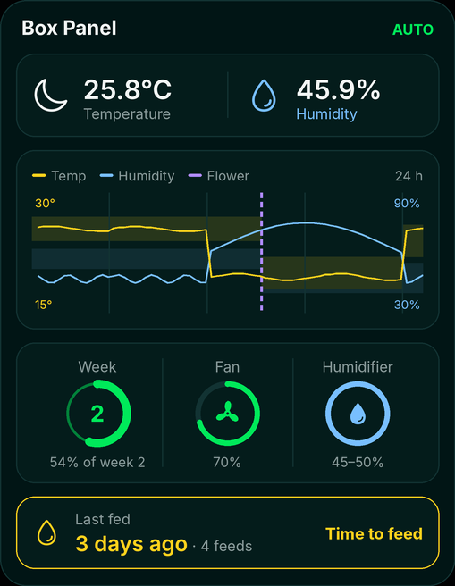
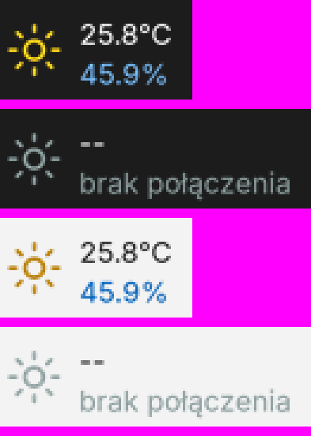

# Growbox Windows widget

A desktop panel and a taskbar readout for the GrowBox controller. It is a
port of the [macOS widget](https://github.com/growbox-DIY/macos-widget): the
same cards, colours, icons (Ionicons from the [app](https://github.com/growbox-DIY/app))
and rules. Controller: [firmware](https://github.com/growbox-DIY/firmware), shelf screen:
[external-monitor](https://github.com/growbox-DIY/external-monitor).

Taskbar readout:

The panel shows:

- temperature with a sun or moon icon, following the lamp relay,
- humidity,
- a 24 h climate chart with the target bands and the flowering start line,
- flowering week, fan (the icon spins faster at higher power) and
  humidifier,
- last feeding: day 3 yellow, day 4 red, "Feeded" for 24 h after feeding.

## What it does

- Polls the main ESP every 10 s (`/api/config`) and the climate log every
  5 min.
- After 3 failed attempts it looks for the ESP (`esp32.local`, then a scan
  of the local /24 network) and remembers the new address.
- Day 4 without feeding: a Windows notification every 2 h between 8:00
  and 22:00.
- Temperature and humidity on the taskbar, right next to the Windows
  weather, in two lines like the weather. Drag them sideways with the
  mouse. Left click shows or hides the panel, right click opens the menu.
  Hidden while a game or a video runs full screen.
- Optional: two tray icons with the numbers next to the clock (menu →
  tray icons).
- Borderless window that stays below other windows, like on the Mac. Drag
  it with the mouse. Right click opens the menu: refresh, hide panel,
  numbers on the taskbar, tray icons, always on top, start with Windows,
  change token, quit.

Missing compared to the Mac: the translucent background.

## Install

1. Python (once): `winget install Python.Python.3.12` in a terminal (or the
   installer from python.org with "Add to PATH" checked).
2. Copy the whole `growbox-widget-windows` folder (with `assets`) to the
   Windows computer.
3. Double-click `install.bat`. It installs Pillow and pystray and starts
   the widget.
4. On first start the widget asks for the main ESP's API token (the same
   one the app and the macOS widget use).
5. Right click the widget → start with Windows.

After that, double-click `growbox_widget.pyw` to start it.

Settings (ESP address, token, window and taskbar positions) are stored in
`%APPDATA%\GrowBoxWidget\settings.json`.

## License

This project is licensed under [CC BY-NC 4.0](https://creativecommons.org/licenses/by-nc/4.0/):
you may use, share and modify it for non-commercial purposes, with credit to
growbox-DIY. See LICENSE.
